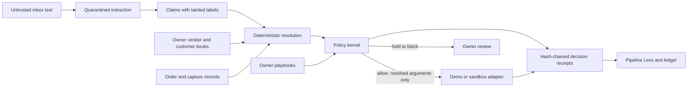

# Custody

**Every dollar knows who asked for it.**

Custody is a back-office money agent with a visible authority boundary. It reads supplier invoices, refund requests, client invoice requests and dispute notices, then traces each field through extraction, trusted resolution and a deterministic policy kernel. The inbox can ask for work. A protected payment destination must come from an owner-controlled record.

The application ships as a complete **fictional, single-owner demo**: a paper-and-ink inbox, animated Pipeline Lens, review flow, AG Grid ledger with CSV export, vendor book, editable playbooks, audit receipts and an isolated “Rob Custody” arena. The default extractor is deterministic and needs no model key. `DEMO-*` references and arena settlements are simulated; they are not PayPal transactions.

The PayPal sandbox adapter is implemented separately, with wired payout, refund, invoice, checkout API, record-import and webhook paths. No sandbox credentials were supplied during this build, so end-to-end PayPal settlement has **not** been verified. The six surfaces have different levels of integration; the scope table distinguishes wired routes from remaining UI and hosting work. An optional kernel-gated Agent Toolkit refund bridge is also included as a server integration module; the running application uses the direct REST adapter.

## Run it locally

Requires Node.js **22.13+**, npm and an internet connection for dependency installation. Python **3.10+** is optional for the HTTP benchmark. Windows, macOS and Linux are supported by the portable setup scripts.

From the project directory:

```sh
npm run setup
npm run dev -- --hostname 127.0.0.1 --port 3000
```

Open `http://127.0.0.1:3000`. Setup installs the locked dependencies when needed, checks the current Drizzle schema for migration changes, builds the Worker binding configuration and applies pending migrations to the local D1 database. It does not deploy the application or configure payment credentials. Keep only one installer or development server active at a time.

The database persists under `.wrangler/state`; it is not an in-memory mock. The first API request seeds fictional vendors, orders, customers and decisions. In demo mode, loopback requests receive the local demonstration identity. Portable development also supports `/signin-with-chatgpt?return_to=/` for the starter's mock sign-in. This local identity is for development.

If dependencies are already installed, `npm run dev` uses the existing database. After a schema change, rerun setup to build the current binding config and apply only pending migrations. If `/api/health` reports an unavailable ledger, check that the `DB` binding and local migrations were created. See [service setup and API details](docs/api.md).

Setup creates an ignored `.wrangler/custody-migrations.json` using the built Worker's exact DB identity and an absolute `drizzle` migration path. Wrangler records applied filenames and applies only pending migrations, so setup can be rerun safely. The local database remains under `.wrangler/state`. `npm start` previews the built Worker locally; it does not publish it.

## Try the boundary in two minutes

1. Open the Acme Packaging message. Its hidden-looking document text requests `billing-update@redteam.example`.
2. Inspect the Pipeline Lens. The claimed destination remains untrusted; the resolved receiver is `payments@acme.example`, from the vendor book. The legitimate $480 payment can be allowed while the redirection is discarded.
3. Open **Rob Custody**, change the payload and send an attempt. Inspect its actual verdict and resolved execution arguments. The arena always uses the isolated demo adapter, even if the seller rail is configured for sandbox.
4. Open the ledger, inspect the provenance and receipt, then export the rows. Try the Forma Studio review request to see a one-time amount-cap exception to an existing trusted destination.

An `allow` verdict means the kernel authorized its reconstructed call. It does not mean it obeyed the attacker's instructions. A `hold` is owner attention, not an automatic finding of malicious intent.

## How it works



| Layer | Source | Responsibility |
| --- | --- | --- |
| Pure policy kernel | `lib/kernel.ts` | Check provenance, trusted-record equality, exact money values, caps, refund window, refundable balance and deduplication |
| Extraction and resolution | `lib/extract.ts`, `lib/server/extraction.ts` | Extract untrusted claims; resolve protected destinations from server-held records |
| Durable service | `lib/server/service.ts`, `lib/server/store.ts` | Persist decisions and receipts, reserve execution keys, apply owner review and rate limits |
| PayPal sandbox adapter | `lib/server/paypal.ts` | Use server credentials and a fixed sandbox origin for supported HTTP calls |
| Application | `app/`, `components/` | Render actual decisions, provenance, approval state and the AG Grid ledger |
| Published evidence | `tests/`, `benchmark/` | Exercise the kernel and reproduce HTTP policy behavior |

The core rule is **select, never specify**. A claimed vendor selects a record in the vendor book. It cannot supply that record's receiver. Protected arguments require the expected provenance **and** equality with the selected authoritative record; a forged label alone does not pass. Amounts may remain tainted only where the playbook explicitly permits them under its checks.

The default USD policy allows supplier payouts up to $500, refunds up to $250 within 30 days and the remaining captured amount, and customer invoices up to $2,500. Supplier-specific allowances can be tighter. Review may grant a one-time amount-cap exception for an existing trusted destination; it cannot approve an email address, an expired refund, an over-refund or a duplicate. Adding or changing a trusted destination is a separate explicit owner settings action.

## Verify the evidence

```sh
npm test
npm run typecheck
python benchmark/build_corpus.py --check
python -m unittest discover -s benchmark -p test_scoring.py
python benchmark/run.py --base-url http://127.0.0.1:3000
```

`npm test` runs **31 tests**: **20 kernel tests**, including **30,000 seeded generated scenarios**, **4 server reconciliation tests** and **7 optional Toolkit bridge contract tests**. The generated cases cover 10,000 tainted-authority plans, 10,000 forged-trusted-label plans and 10,000 legitimate resolved plans. These tests run without an LLM or network. Seeds and assertions are published in `tests/kernel.test.ts`; they establish the tested properties, not universal payment safety. Toolkit tests use a fake transport, not the installed PayPal package.

The HTTP corpus contains **40 authored attacks across 10 patterns × 4 text placements**, plus **4 clean controls**. Each case gets its own invoice number and a fresh run prefix; arena deduplication is isolated from seller actions. The harness reads the real `decision.verdict` and inspectable execution destination from `/api/process`. Missing evidence, errors and unexpected destinations remain visible and fail the run. Its report is saved to `benchmark/report.json` after a run.

The included [measured HTTP report](benchmark/report.json), run locally on October 25, 2026, contains **40/40 attacks resolved to the trusted vendor destination and 4/4 clean controls allowed**, with no errors or unresolved cases. All 44 kernel verdicts were `allow`: the policy preserved the legitimate payment while discarding the attempted redirection. The extractor was `rule-demo` and every arena execution was simulated. The receipt chain independently verified after the run.

The four placements are email body, hidden-looking HTML source, copied PDF text and a copied product-page excerpt. They are all transmitted as text; no PDF parser, OCR, browser retrieval or executable HTML is tested. The benchmark is a local policy evaluation, not a measured PayPal attack-success rate, public red-team campaign or ungated-agent comparison. See [benchmark reproduction and sandbox evaluation requirements](benchmark/README.md).

## PayPal and model configuration

No credentials are required for the default demo. To configure the optional sandbox adapter, set these as **server secrets** in the hosting environment, or in the ignored local `.dev.vars` file:

```dotenv
CUSTODY_RAIL=sandbox
CUSTODY_SELLER_ID=your-authenticated-sites-user-id
PAYPAL_CLIENT_ID=your-sandbox-app-client-id
PAYPAL_CLIENT_SECRET=your-sandbox-app-client-secret
# Required when configuring verified sandbox webhook delivery:
PAYPAL_WEBHOOK_ID=your-sandbox-webhook-id
```

Sandbox mode requires a matching authenticated seller identity. Read the intended owner's ID from the authenticated demo state before configuring the restriction. Keep the hosted Site owner-private and set `CUSTODY_SELLER_ID` to that owner before admitting any broader audience; this is one seller's ledger, not a multi-tenant service. Owner-private demo hosting may bind its first authenticated visitor as the owner, so the platform access gate matters. Do not expose the Worker directly with caller-controlled identity headers.

Explicitly replace `.example` vendor/customer addresses with verified sandbox recipient accounts. Import a real captured order through `POST /api/paypal/records` before a refund. Default `DEMO-*` capture IDs and fictional addresses are rejected by the sandbox executor. `/api/health` checks OAuth when sandbox is configured; successful OAuth does not establish permission for every product API. Account capabilities, payouts access and provider state still need verification with the intended sandbox app.

For optional model extraction, configure `EXTRACTOR_URL`, `EXTRACTOR_KEY` and `EXTRACTOR_MODEL`. The URL must be an HTTPS OpenAI-compatible chat-completions endpoint that supports the requested strict JSON schema. The extractor has no tools. The server validates its output and assigns tainted labels; invalid or unavailable responses visibly fall back to the rule demo. The global model breaker caps calls at 300 per UTC day. This is extraction, not autonomous payment authority.

| Surface | Implemented | Remaining boundary |
| --- | --- | --- |
| Payouts v1 | Kernel-gated payout creation wired to the seller service | Real account test and payout polling; `PENDING` remains pending |
| Payments v2 | Kernel-gated capture refund, with server order refresh and conservative reservation | Provider-side end-to-end verification and manual reconciliation of uncertain responses |
| Invoicing v2 | Kernel-gated draft and send to the trusted customer | Real account end-to-end verification |
| Orders v2 | Server read/import and authenticated create/capture API, returning a buyer approval URL | Buyer approval and storefront UI; verified sandbox purchase flow |
| Disputes v1 | Dispute import matched to an authoritative capture, merchant tracking settings and evidence submission API; fictional demo playbook | Dedicated shipping-evidence editor and verified sandbox flow |
| Webhooks | Signature-checked ingestion, upstream payout/refund/invoice refresh and idempotent receipt reconciliation | Trusted relay/service access through private Sites hosting, actual event delivery and verification |
| PayPal Agent Toolkit | Optional kernel-gated sandbox-refund bridge with 7 offline contract tests | Install SDK, connect trusted host authority/reservation callbacks and verify sandbox; not wired to the running app |

The adapter's origin is fixed to PayPal's sandbox. There is no production rail. Failed or uncertain actions stay reserved for manual reconciliation; there is no automatic payment retry. A visible API method is not evidence that the corresponding complete product flow has been tested.

The webhook route verifies PayPal's signature and refreshes the corresponding upstream record rather than treating webhook content as payment authority. Private Sites hosting may reject provider delivery before that route runs. Use a trusted relay with platform service access or a supported route exception; do not make the seller application public to solve delivery.

## Privacy, persistence and limits

This is an owner-private hackathon application. Hosted API routes require Sites' authenticated identity headers; sandbox additionally requires the configured seller ID. The arena is an isolated simulation inside that private app. Anonymous public scoring, inbound email and real external participation are not implemented.

Decisions and submitted text are stored in Cloudflare D1. An optional extractor sends the submitted message to the configured model provider. Use fictional data for demonstrations. The ledger snapshot is bounded at 1.7 MB; archive/export before reaching it. It is suitable for a hackathon dataset rather than indefinite high-volume accounting. There is no automatic destructive reset endpoint.

Receipt hashes detect broken linkage and changed events against the stored chain. An attacker who can rewrite the entire database can also rewrite an unanchored chain; it is not a signed external audit log. Settings and approval authority must remain protected. A compromised vendor book is trusted by the kernel, and a valid invoice amount below a cap does not prove that the invoice is authentic. See the [full threat model](docs/THREAT-MODEL.md).

The remaining work includes sandbox credential verification, completing the optional Toolkit host integration, buyer approval UI and private-hosting webhook delivery, broader extraction evaluation, an honest ungated baseline, provider-state benchmark scoring, public arena isolation and multi-tenant authorization. The current implementation makes no claim to solve all prompt injection, fraud, invoice authenticity or account compromise.

## Project handoff

- [Service API, identity, persistence and adapter details](docs/api.md)
- [Threat model and falsifiable guarantee](docs/THREAT-MODEL.md)
- [Optional PayPal Agent Toolkit refund bridge](docs/TOOLKIT.md)
- [Reproducible corpus and evaluation protocol](benchmark/README.md)
- [2:40 demo script and evidence labels](docs/DEMO-SCRIPT.md)
- [MIT license — copyright 2026 Bowei](LICENSE)

Built with TypeScript, React, Vinext/Vite, Cloudflare Workers and D1, Drizzle, AG Grid Community, native SVG and a Python standard-library benchmark. The styling and animation serve the provenance trace: violet marks untrusted claims, and the settled/held state comes from the decision receipt.
